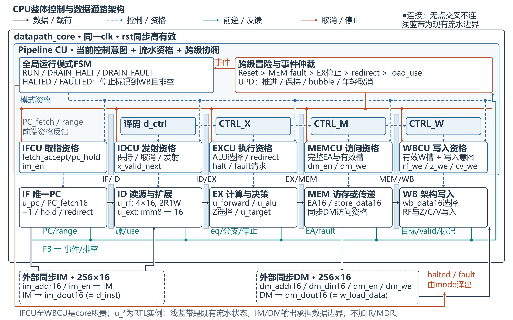

# 16位五级流水线CPU

本仓库集中保存本项目目前留存的全部成果：正式规格、Pre1–Pre5汇报与讲稿、RTL、Testbench、Vivado工程与脚本、程序镜像、原始验证与综合记录、可编辑图形，以及早期交付和修订归档。用于后续检查与优化架构。

当前实现基线为 **v1.6-timing-AC1**，指令集为 **ISA v1.5**。所有接受且未取消的指令按 IF → ID → EX → MEM → WB 组织；STR在MEM写DM一次后仍保留有效WB标签，分支在EX重定向后自身继续传递。现有流水寄存器、前递、互锁、取消与停止状态机共同处理冒险。

## 先看这些

1. [CPU核心设计文档 Word](CPU核心设计/16位流水线CPU核心设计文档_AC1候选版.docx) · [同版PDF](docs/16位流水线CPU核心设计文档_AC1候选版.pdf)：46页，按ISA、数据通路、典型指令流程、源码与验证组织。当前两张主图在第9–10页。
2. [整体控制与数据通路架构 SVG](CPU核心设计/架构图/01_CPU整体架构.svg) · [PNG](CPU核心设计/架构图/01_CPU整体架构.png)。
3. [五级Datapath详细连接 SVG](CPU核心设计/架构图/02_五级Datapath.svg) · [PNG](CPU核心设计/架构图/02_五级Datapath.png)：目标计算、Z选择与分支判定独立，画出实际前递、写回、Z反馈及四个流水边界。
4. [Buffer/Interlock说明](CPU核心设计/CPU流水线冒险与Buffer_Interlock完整设计方案.docx)。
5. [当前RTL](CPU核心设计/Vivado/rtl) · [Testbench](CPU核心设计/Vivado/tb) · [程序镜像](CPU核心设计/程序镜像) · [工程入口](CPU核心设计/README.md) · [证据索引](CPU核心设计/证据索引.json)。



## 全部成果目录

| 目录 | 内容与用途 |
|---|---|
| [CPU核心设计](CPU核心设计) | 当前AC1正式文档、源码、工具入口、镜像、验证和时序记录 |
| [Pre1_CPU技术规格](Pre1_CPU技术规格) | 初步规格、正文源、架构图、设计级参考模型及核对记录 |
| [Pre2_加法器EDA](Pre2_加法器EDA) | 加法器EDA汇报、讲稿、综合图及全量测试记录；更多整合版见微信留存 |
| [Pre3_ISA与数据通路模块](Pre3_ISA与数据通路模块) | 小组PPT、C部分讲稿、模块源码/仿真/综合依据、CLA与C/V设计增量 |
| [Pre4_数据通路设计与验证](Pre4_数据通路设计与验证) | 最终PPT、数据通路图、RTL与验证、连续连接图及离线查看器 |
| [Pre5_控制单元设计](Pre5_控制单元设计) | 英文汇报、教师查阅版、讲稿、分工、同源CU验证及逐拍控制记录 |
| [历史归档](历史归档) | 文档修订前版本、绘图/Word制作源、排版预览、复核记录；Shudian历史恢复源码及三次提交的Git bundle |
| [补充历史成果/微信留存](补充历史成果/微信留存) | 从本项目附件目录补齐的早期PPT、分部材料、旧Word及原交付ZIP/RAR，按月份保留原名 |
| [配套成果/Datapath_Lab网站源码](配套成果/Datapath_Lab网站源码) | 数据通路交互查看器的本地源码、SVG和数据；本次只归档，未另行部署网站 |

详细文件数量、字节数和SHA256见[成果清单](docs/成果清单.csv)及[上传快照清单](docs/上传快照清单.json)。历史文件原名、内容、日期语义和执行receipt均保留，不把旧版本改写成当前版本。相同内容在不同交付中重复出现时也保留其归属。

## 版本和验证口径

- 当前入口是 `CPU核心设计`。Pre1至Pre5及微信留存中的“当前”“最新”等表述属于各自当时的上下文；跨版本查阅以本页为准。
- 最终Pre4属于历史v1.4映射；当前ISA v1.5中AND/OR为Opcode 2/3，LDR/STR为8/9。旧二进制镜像不可直接当作新ISA程序。
- 当前CPU是16位、4个普通可写通用寄存器、顺序单发射五级流水、固定单周期同步IM/DM、Harvard结构。C表示加法进位/减法无借位，V表示有符号溢出；ADD/SUB写C/V，CMP写Z。
- 既有功能证据包括九套回归、独立48例、冒险矩阵及控制逐拍记录。具体运行日期、覆盖范围和输入指纹保留在原日志/JSON中。本次上传不是新运行XSim。
- AC1已存核心OOC结果为287 LUT、260 FF、15 CARRY4、10ns目标下WNS +2.620ns/TNS 0。它不是完整布局布线、板级100MHz或下板通过结论。ISA/流水行为不因本次归档而改变。
- [已清理历史项及资料边界](docs/已清理历史项与资料范围.md)记录用户已确认清理的两个旧归档，以及本次归集范围。

## 从源码开始复跑

在Windows中进入 `CPU核心设计`，按该目录README配置Vivado2025.2入口后运行：

```powershell
.\Vivado\create_project.ps1 -ProjectDirectoryName project_new
.\Vivado\run_verify.ps1
.\Vivado\run_synthesis.ps1
```

当前记录使用器件 `xc7z020clg484-1`，OOC top为 `datapath_core`；已有工程不要直接覆盖。原始记录含当时本地绝对路径，这些路径用来追溯来源，不是克隆后必须存在的目录。新的执行须使用新的attempt并保存自身证据。

本次同步保留仓库已有MIT许可。参考用教师课件和教材原件未作为项目成果复制；其引用和课程要求保留在技术文档及阶段记录中。
